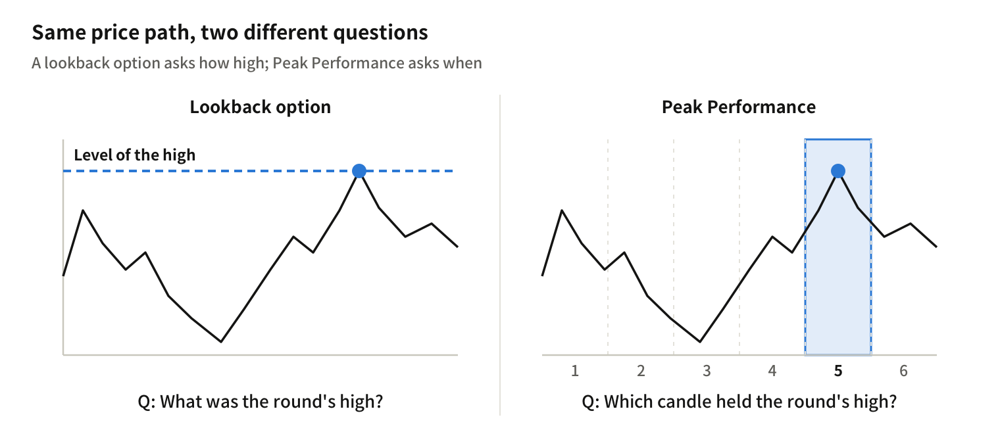

# Peak Performance

### Overview

Each Peak Performance round lasts 60 seconds and is made up of six 10-second candles. Before the round starts, you predict which candle will hold the round's highest price and which will hold its lowest price. If your prediction is correct, you are paid out at the payout multiplier fixed when you placed the order; if not, you lose the order amount. Behind every card is a timing digital option on the extremum; see Section 3 for how it is priced.

| Item             | Details                                                                                                                     |
| ---------------- | --------------------------------------------------------------------------------------------------------------------------- |
| Underlying       | BTC-USD                                                                                                                     |
| Round length     | 60 seconds, six 10-second candles                                                                                           |
| Modes            | Single: predict the candle with the high, or the candle with the low. Pair: predict both the high candle and the low candle |
| Amount per order | 1–500 USDC, Custom amounts supported                                                                                        |
| Order cutoff     | Orders can be placed any time before the next round starts                                                                  |
| Maximum loss     | The order amount                                                                                                            |

### How the high and low candles are determined

Each candle has its own high and low, wicks included. Among the round's six candles, the one with the highest high is the "high candle" and the one with the lowest low is the "low candle". Prices are compared after rounding the price-source quote to two decimal places.

| Outcome     | Rule                                                                                                     |
| ----------- | -------------------------------------------------------------------------------------------------------- |
| High candle | The candle with the highest high of the round's six                                                      |
| Low candle  | The candle with the lowest low of the round's six                                                        |
| Tie         | Two or more candles have exactly the same high (or low) to two decimal places: the earlier candle counts |

For example, if candle 2 has a high of 75,996.40 and the other five candles all have lower highs, candle 2 is the high candle. If candle 6 has a low of 75,941.10, the lowest of the round, candle 6 is the low candle.

How each mode is settled:

* Single: pick one candle for the high, or one candle for the low. The side you pick is judged and settled on its own.
* Pair: pick one high candle and one low candle. Both must be correct; getting only one side right counts as a miss.

While the round is live, your card shows "Still in play" as long as the candle you picked can still become the high or low. It keeps this status until the last candle closes and the round settles.

### Pricing Peak Performance with options

Within any minute, price always makes one high and one low. Peak Performance asks: in which of the six 10-second candles does each of them occur?

**In one line: Peak Performance is a timing digital option on the extremum. It doesn't ask whether price goes up or down, or how much it moves. It asks about the shape of the price path.**

Options markets have studied this kind of question for a long time. Peak Performance is a path-dependent exotic option and belongs to the same family as the lookback option. A lookback option is built around a period's highest and lowest prices and asks what the highest price was; Peak Performance asks when it occurred. Both look at the same price path, and both are priced with the same probability tools.

<figure><figcaption></figcaption></figure>

Lookback option vs Peak Performance · the same illustrative path

Behind every Peak Performance card is a timing digital option on the extremum with an all-or-nothing payout: if the condition is met, you are paid at the payout multiplier; if not, the option expires worthless. The fair price of such an option is the probability that the condition is met. So pricing a card comes down to one question: how likely is it that the candle you picked becomes the round's high or low?

Pricing takes four steps: **decompose** each card into the options behind it, **price** them from how price paths behave, **combine** them according to the card's mode (Single maps to one option directly; Pair also accounts for how the high and the low move together), and finally add the platform spread to form the **quote**. Every payout multiplier you see is calculated by this pricing framework from current market conditions.

You don't need to know about lookback options or path dependence. You only need a view on how the next minute will trade: in a one-way move, the high and the low usually sit at the start and the end; in a spike-and-fade or a dip-and-recover, the high or the low lands in the middle. **Every view you take is a price on the shape of a price path.**

<figure><figcaption></figcaption></figure>

Three typical price paths · illustrative

#### Decompose: six candles per round, two sets of timing digital options

An option has three elements: the underlying, the expiry and the payout condition. In Peak Performance, the underlying is BTC, expiry is the moment the round's last candle closes, and the payout condition is "the round's high (or low) falls within the 10 seconds of candle k". Unlike a standard option, the round has not started when you place your order: the observation window only begins when the first candle of the next round opens, and that opening price is only set at that moment. Options like this are known as **forward-start options**.

The outcome depends on the whole round's price path, not on the price at any single moment: a high made in candle 1 can be overtaken in candle 6, so the result is only known once the last candle closes. Options like this are known as **path-dependent options**, and the **lookback option** is the classic example.

<figure><figcaption></figcaption></figure>

One price path split into six candles · illustrative

In this round the high falls in candle 5 and the low in candle 3. Candle 1 was briefly the highest, but once it is overtaken later in the round it is no longer the high candle.

| Your pick        | What it corresponds to in options markets       | When it pays out                   |
| ---------------- | ----------------------------------------------- | ---------------------------------- |
| High in candle k | Timing digital option (on when the high occurs) | The round's high falls in candle k |
| Low in candle k  | Timing digital option (on when the low occurs)  | The round's low falls in candle k  |

In other words, **the moment a round begins, two sets of timing digital options are listed at once**: six for the high and six for the low. The six options in a set don't overlap, since the round's high can only fall in one candle, so their probabilities add up to exactly 100%: if one goes up, the others go down. They can't be priced in isolation; each set has to be priced together within one probability framework.

#### Price: why the first and last candles are most likely to hold the extremes

Intuitively, each of the six candles might seem to have a one-in-six chance of holding the high. But price paths don't split it that way.

**The first and last candles have the edge; the middle two are the hardest.** Candle 1 is where the round starts: if price spikes right at the open and never gets back there, that high holds. Candle 6 is where the round ends: after the final push, there is no time left to overtake it. A middle candle has to hold on both sides: nothing before it can be higher, and nothing after it can beat it. So the chance of holding the high is U-shaped: highest at the two ends, lowest in the middle. The same holds for the low.

In mathematics this is known as the **arcsine law**, first described by the mathematician Paul Lévy. It describes exactly when the extremes of a random price path tend to occur, and it is one of the foundations of pricing lookback-style options. In the quotes, the options on the first and last candles usually cost more and carry lower payout multipliers; the middle candles are the reverse.

<figure><figcaption></figcaption></figure>

U-shaped distribution · bar heights show relative size only, not actual values

The taller the bar, the more likely that candle is to hold the round's high: the first and last candles stand well above the middle, and the middle two are lowest.

On top of this U shape, three market features affect pricing:

* **Volatility doesn't change the U shape.** This is the biggest difference between Peak Performance and a standard option. A standard option's price depends heavily on volatility, but which candle holds the high depends only on the shape of the path, not its size. Double every move along the same path and the high still sits in the same candle. Whether the market is wild or calm, the U shape stays broadly the same.
* **Short-term momentum deepens the U.** 10-second candles show short-term momentum: a move up is more likely to keep going up. When price trends all the way through a round, the high and the low are pushed to the first and last candles; when price chops back and forth, the middle candles' chances rise.
* **Ties can occur in quiet markets.** When price barely moves, two candles can print exactly the same high. The tie probability reflects how active the market is; it is measured from actual trading data and built into pricing. See Section 2 for how ties are handled.

#### Combine: a dual digital option linking the high and the low

Pair requires both the high and the low to be correct: one contract with two conditions. An option that pays out only when two conditions are both met is known as a **dual digital option**. But these two conditions are not independent: where the high falls affects where the low falls. The two conditions therefore can't be priced separately and multiplied together; they have to be priced jointly on the same price path, because once the path is set, the positions of the high and the low are set together.

| High and low positions            | What kind of price action                                      | Relative difficulty |
| --------------------------------- | -------------------------------------------------------------- | ------------------- |
| One at each end (candles 1 and 6) | A one-way move through the round, straight up or straight down | Easiest             |
| Far apart                         | A spike then a pullback, or a dip then a rebound               | Fairly easy         |
| In adjacent candles               | The round's whole range is set within 20 seconds               | Hardest             |

So a Pair's price is not the product of two Single prices: combinations with one extreme at each end are more likely to hit than multiplication suggests and carry lower payout multipliers, while combinations with the high and low close together are less likely to hit and carry higher ones.

#### Quote: fair price plus the platform spread

Design each timing digital option to pay 1 USDC if it hits and 0 if it misses, and its fair price is roughly its probability of hitting. That gives the price an intuitive meaning: an option quoted at 0.20 USDC means the market sees about a 20% chance that this candle holds the round's extreme. The higher the price, the higher the conviction.

When options market makers quote, they add a spread on top of the fair price as compensation for taking on risk. Peak Performance works the same way: quote = fair price + platform spread, and the spread is already included in the payout multiplier shown on the page.

To keep things simple, the page shows a payout multiplier instead of the contract price: the payout, including your amount, for every 1 USDC if the prediction is correct. The lower the contract price, the higher the multiplier; the harder the outcome, the higher the multiplier. For example, a quote of 0.20 USDC corresponds to 5.00x: an order of 10 USDC pays 50 USDC if it hits. Payout multipliers are shown to two decimal places.

### When payout multipliers change and when they're fixed

Peak Performance's pricing framework is fixed; what changes is the market.

The U shape comes from how price paths behave and doesn't move with market conditions. Two inputs do move with the market: whether price is currently trending or chopping, and how likely price is to stand still and produce a tie. When either changes, the fair price of the same card is recalculated, just as the same option is quoted differently at different times.

* In trending markets, momentum strengthens: payout multipliers on the first and last candles usually fall, and those on the middle candles usually rise.
* In choppy markets, momentum weakens and the gaps between candles usually narrow.
* In quiet markets (such as weekends or late at night), ties become more common, and payout multipliers adjust under the tie rule in Section 2.

Pricing inputs refresh every 60 seconds. A payout multiplier reflects pricing under current market conditions, not compensation for past results: price paths have no memory, and a candle that has rarely held the high recently is no more likely to hold it in the next round.

Your payout multiplier is fixed when you confirm your order, and the order settles at that multiplier.

### Settlement

Candle prices come from the YesFi composite index price, calculated from real-time quotes across multiple external exchanges after outlier filtering and weighting. See [Pricing](https://docs.yesfi.com/perps/market-and-limit/pricing) for details.

* Open: equal to the previous candle's close
* High / Low: the highest and lowest values among the candle's open, close and every quote in between (the open is included)
* Price precision: compared after rounding the price-source quote to two decimal places
* Feed interruptions: if third-party quotes are temporarily unavailable, the platform fills in a quote at the current price every second, so every candle has complete price data

The round settles automatically after its last candle closes, and payouts go straight to your account. Open any round on the candle chart to see its high and low candles and their prices in Round details. The opening and settlement Tx hash for each order are shown in your order history and can be checked on the block explorer.

### Limits and maximum payout

| Limit                              | Value                                |
| ---------------------------------- | ------------------------------------ |
| Amount per order                   | 1–500 USDC, up to two decimal places |
| Maximum payout multiplier per card | 600x                                 |

The maximum payout on a single order is 600 times the order amount. Orders that would exceed this limit are rejected.

### FAQ

**Why are the payout multipliers on the first and last candles usually the lowest?** A price path's extremes are more likely to occur at the start and the end: a high made early holds as long as nothing overtakes it later, and a high made at the end has no time left to be overtaken. Easier to hit means a lower multiplier; see Section 3.2. Payout multipliers also adjust to recent market conditions, so at any given moment the quotes may not be strictly lowest at the two ends. On the low side, for example, candle 2 is sometimes quoted below candle 6.

**Do payout multipliers change when volatility rises?** The size of price moves by itself has little effect on which candle holds the high or the low. What moves the multipliers is whether the market is trending or choppy, and the tie probability in quiet markets; see Section 4.

**If candle 1 spikes at the start, is the high already decided?** No. The result is only final once the last candle closes, and any later candle can still beat it. While the round is live, a card showing "Still in play" means the candle you picked hasn't been ruled out.

**What if two candles have the same high?** If they match exactly to two decimal places, it's a tie; see Section 2 for how ties are handled. Ties usually happen in quiet markets when price barely moves.

**Why isn't a Pair's payout multiplier the product of two Single multipliers?** The positions of the high and the low are linked. Combinations with one at each end hit more often than multiplication suggests, and combinations with the two close together hit less often; see Section 3.3.

**Can I place more than one card in the same round?** Yes. You can hold up to three cards in one round: one Single on the high, one Single on the low and one Pair. Each card settles at its own payout multiplier, and the platform spread applies to each card separately.

**How can I check a settlement?** Open the round on the candle chart to bring up Round details, which shows the round's start and end time, the high and low candles and their prices, and the round's open, high, low and close. Each order's result and Tx hash are shown in your order history.

### Risk disclosure

Each Peak Performance round lasts only 60 seconds, and an incorrect prediction loses the full order amount. Payout multipliers already include the platform spread. Peak Performance is a prediction product designed on option-pricing principles, not an exchange-listed option contract; orders are held until the round ends and settled together. Nothing on this page is investment advice. Only use funds you can afford to lose.
